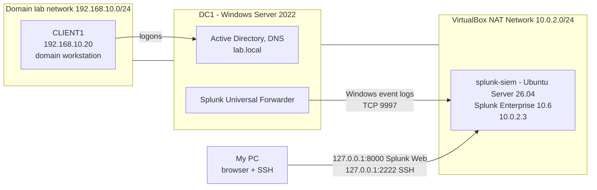

# SIEM Home Lab: Splunk + Windows Server 2022

A home lab I built from scratch to practice the work of an IT support technician, SOC analyst, and network administrator: building servers, connecting networks, collecting logs, investigating security events, and documenting everything.

**Author:** Mark Lopez Balbuena · CompTIA A+, Network+, Security+ · Microsoft AZ-900, AI-900 · LPI Linux Essentials
**Started:** October 2026 · **Status:** In progress

---

## What this lab does

Splunk Enterprise runs on an Ubuntu server and collects Windows security logs from a Windows Server 2022 domain controller. I use it to search those logs, investigate logons, and write case notes the way a SOC analyst would.



DC1 has **two network adapters**: one on the existing Active Directory lab network (192.168.10.10) and one on the NAT Network (10.0.2.4) so it can send logs to Splunk without breaking the domain lab.

## Skills demonstrated

| Skill | Where to see it |
| --- | --- |
| Troubleshooting (structured, step by step) | [Troubleshooting log](docs/04-troubleshooting-log.md): 10 real problems, cause, and fix |
| Windows Server, Active Directory, user accounts | [Lab architecture](docs/01-lab-architecture.md), [case notes](case-notes/) |
| Networking: IP addressing, NAT, port forwarding, DNS, routing | [Lab architecture](docs/01-lab-architecture.md), [troubleshooting log](docs/04-troubleshooting-log.md) |
| Linux command line and services (systemctl, apt, SSH) | [Splunk server setup](docs/02-splunk-server-setup.md) |
| SIEM / log collection | [Forwarder setup](docs/03-forwarder-setup.md) |
| Security investigation | [Case notes](case-notes/) |
| Splunk SPL searches | [Searches I use](splunk-queries/searches.md) |
| Documentation | Every file in this repo, plus the [screenshot gallery](screenshots/README.md) |

## Repository contents

```
docs/
  01-lab-architecture.md       VMs, IP plan, network design
  02-splunk-server-setup.md    Ubuntu + Splunk install, boot-start, receiving port
  03-forwarder-setup.md        Universal Forwarder on Windows Server, inputs.conf
  04-troubleshooting-log.md    Problems I hit and how I fixed them
case-notes/
  CN-001-failed-logon-console.md        Failed logons, benign
  CN-002-anonymous-network-logon.md     Anonymous logon from CLIENT1, benign
  CN-003-brute-force-simulation.md      Tabletop exercise: brute force + success, escalated
splunk-queries/
  searches.md                  SPL searches with what each one answers
reference/
  windows-logon-types-and-event-ids.md
screenshots/                   55 screenshots by stage, with a captioned gallery
```

## Highlights

- **32,000+ Windows events** collected and searchable in Splunk
- Found and fixed a **hidden `.txt` extension** that stopped all log collection (`inputs.conf.txt`)
- Found a **3-hour timestamp error** caused by a wrong time zone on the server, and a **UTC display** mismatch in Splunk
- Baselined **logon types** on the domain controller (Type 3 network: 3,183 · Type 5 service: 950 · Type 2 keyboard: 124)
- Investigated an **ANONYMOUS LOGON** with NTLM V1 and documented why it was a false positive

## What's next

- [ ] Install Sysmon for process and network visibility
- [ ] Build a Splunk alert for repeated failed logons, and a dashboard
- [ ] Simulate attacks from Kali and investigate them
- [ ] Phishing, suspicious sign-in, and malware investigations
- [ ] Networking track: CCNA labs (VLANs, routing, ACLs) added to this portfolio

## Tools

VirtualBox · Ubuntu Server 26.04 LTS · Splunk Enterprise 10.6 · Splunk Universal Forwarder · Windows Server 2022 · Active Directory · PowerShell · Bash
