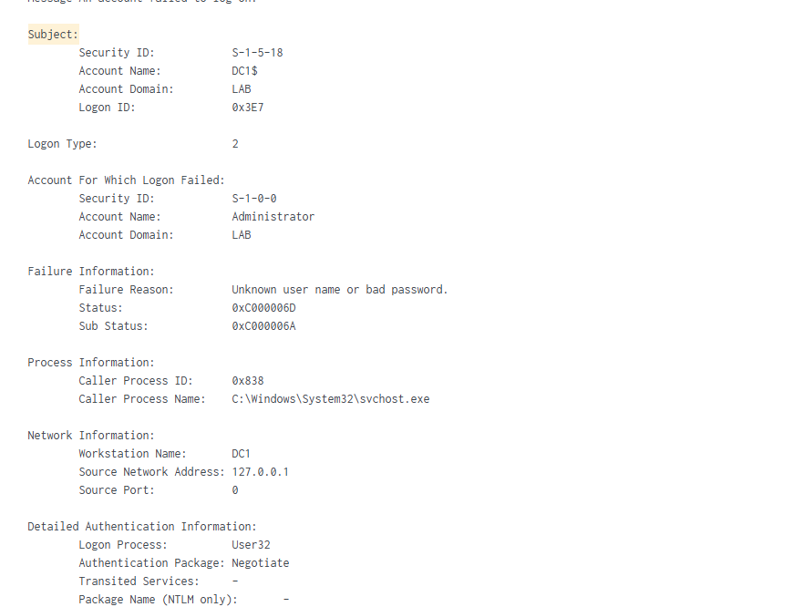

# CN-001: Failed Logon at the Console

| Field | Value |
| --- | --- |
| Alert | Failed logon (Event 4625), 2 events |
| Date | 10/23/2026, about 2:50 PM |
| Host | DC1 |
| Account | LAB\Administrator |
| Verdict | **Benign** |
| Escalate | No |

## What I checked

- **Logon Type 2** (at the keyboard), **Logon Process User32** (the Windows login screen)
- **Source 127.0.0.1**: the attempt came from DC1 itself, not another machine
- **Sub Status 0xC000006A**: the username exists, but the password was wrong
- Only 2 failures, followed by a **successful logon (4624, Type 2)** for the same account
- The Subject account **DC1$** is the server's computer account processing the request, not the account that failed

## Searches

```
index=windows EventCode=4625
index=windows EventCode=4624 Logon_Type=2
```

## Verdict

Benign: a password typo by the administrator at the console.

## Escalation

No. The attempts were local, few, and resolved by a successful logon. I would escalate repeated failures from a network source (Logon Type 3 or 10), especially against the Administrator account.


