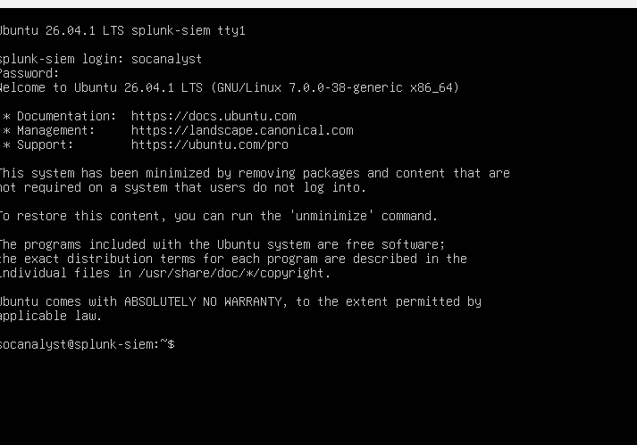

# Splunk Server Setup (Ubuntu Server 26.04)

## 1. Create the VM

- VirtualBox VM "splunk SIEM": 8 GB RAM, 4 CPUs, 60 GB disk
- The default virtual disk was 25 GB, so I enlarged it to 60 GB before installing (File > Tools > Media) because Splunk stores every log it collects.
- During install, I expanded the `/` partition to use the full disk (the guided install only gave it half) and enabled **OpenSSH server**.

## 2. Update the system

```bash
sudo apt update && sudo apt upgrade -y
sudo apt install -y iputils-ping   # minimal install did not include ping
```

## 3. Connect over SSH from my PC

```powershell
ssh socanalyst@127.0.0.1 -p 2222
```

This uses the port forwarding rule (host 2222 -> guest 22) and lets me copy and paste commands.

## 4. Download and install Splunk Enterprise

```bash
wget -O splunk-10.6.1.1-b2ae2962645c-linux-amd64.deb "<wget link from splunk.com>"
sudo dpkg -i splunk-10.6.1.1-b2ae2962645c-linux-amd64.deb
```

## 5. First start (as the splunk user, not root)

```bash
sudo -u splunk /opt/splunk/bin/splunk start --accept-license
```

## 6. Start Splunk automatically at boot

```bash
sudo -u splunk /opt/splunk/bin/splunk stop
sudo /opt/splunk/bin/splunk enable boot-start -user splunk -systemd-managed 1
sudo systemctl start Splunkd     # capital S - Linux is case-sensitive
sudo systemctl status Splunkd    # look for "active (running)"
```

## 7. Configure Splunk Web

1. Settings > Forwarding and receiving > Configure receiving > **port 9997**
2. Settings > Indexes > New Index > **windows**
3. Preferences > Time zone > **America/New_York** (Splunk was showing times in UTC)

## Verify

```bash
sudo ss -tlnp | grep -E '8000|8089|9997'
```

Ports 8000 (web), 8089 (management) and 9997 (receiving) should be listening.


