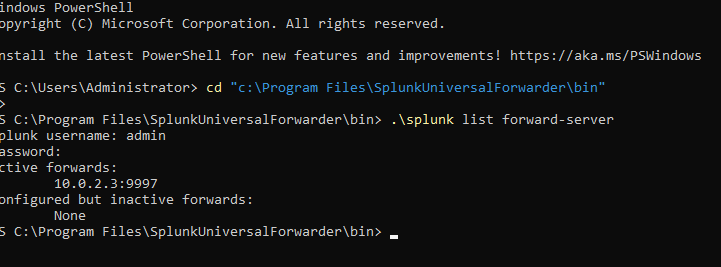

# Universal Forwarder Setup (Windows Server 2022)

The forwarder is a small agent that reads the Windows Event Logs on DC1 and sends them to Splunk. Splunk cannot pull the logs itself, so every monitored machine needs an agent. Real SOCs work the same way with the Splunk forwarder, CrowdStrike, Defender, or Azure Monitor Agent.

## 1. Confirm DC1 can reach Splunk

```powershell
Test-NetConnection 10.0.2.3 -Port 9997
# TcpTestSucceeded : True
```

## 2. Install the forwarder

- Download the Windows 64-bit `.msi` from splunk.com
- Choose "An on-premises Splunk Enterprise instance"
- **Deployment Server:** leave blank (only needed to manage many forwarders)
- **Receiving Indexer:** `10.0.2.3` port `9997`

## 3. Tell the forwarder which logs to send

`C:\Program Files\SplunkUniversalForwarder\etc\system\local\inputs.conf`

```ini
[WinEventLog://Security]
index = windows
disabled = 0

[WinEventLog://System]
index = windows
disabled = 0

[WinEventLog://Application]
index = windows
disabled = 0
```

> Notepad saved this as `inputs.conf.txt` at first, and Splunk ignored it. See the [troubleshooting log](04-troubleshooting-log.md).

## 4. Restart and verify

```powershell
Restart-Service SplunkForwarder

cd "C:\Program Files\SplunkUniversalForwarder\bin"
.\splunk list forward-server
# Active forwards: 10.0.2.3:9997
```



## 5. Confirm in Splunk

```
index=windows
```

Result: 8,270 events on the first check, 32,000+ after a few days.

## 6. Fix the server clock

```powershell
Get-TimeZone
Set-TimeZone -Id "Eastern Standard Time"
w32tm /resync /force
```
