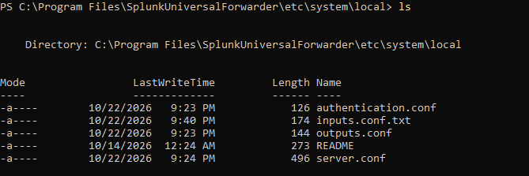
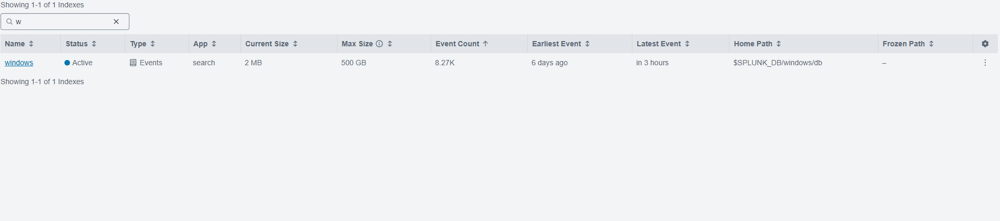
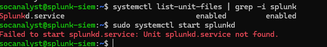
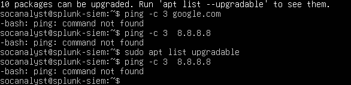

# Troubleshooting Log

Real problems I hit while building this lab, how I found the cause, and how I fixed them. Newest first.

| # | Symptom | How I found the cause | Root cause | Fix |
| --- | --- | --- | --- | --- |
| 10 | Splunk search returned 0 events for EventCode 4625 | Re-checked the search bar | Field names in Splunk are case-sensitive (`Eventcode` vs `EventCode`); also the time range was too short | Used `EventCode`, set time range to All time |
| 9 | Splunk showed times 4 hours off from the event text | Compared Splunk's Time column with the time inside the event | Splunk user preference was UTC | Set Splunk time zone to America/New_York |
| 8 | DC1 could not resolve internet names (`DNS server failure`) | `Resolve-DnsName`, `w32tm /stripchart` | DC1 uses itself for DNS and had no forwarder for internet names | `Add-DnsServerForwarder -IPAddress 8.8.8.8` |
| 7 | Splunk index showed the latest event "in 3 hours" | Logs from the future = wrong clock | DC1 time zone set to Pacific instead of Eastern | `Set-TimeZone -Id "Eastern Standard Time"` |
| 6 | Forwarder installed but index had 0 events | Listed the config folder | Notepad saved `inputs.conf.txt`, which Splunk ignores | `Rename-Item inputs.conf.txt inputs.conf`, restarted service |
| 5 | Forwarder restart froze the VM | VM unresponsive | Limited resources / Hyper-V Memory Integrity on host slows VirtualBox | Powered off the VM; forwarder started on boot |
| 4 | SSH "connection refused" | Checked port forwarding rules and VM state | VM was powered off, and rules pointed to an IP outside the network range | Started VM, matched NAT Network range to the rules (10.0.2.0/24) |
| 3 | `systemctl start splunkd` failed: unit not found | `systemctl list-unit-files \| grep -i splunk` | Service name is `Splunkd` (capital S) | `sudo systemctl start Splunkd` |
| 2 | `ping` gave no reply; assumed no internet | Read the full output | Minimal Ubuntu install had no ping: `command not found` | `sudo apt install iputils-ping`; `apt update` proved internet worked |
| 1 | Ubuntu installer gave `/` only 11.5 GB | Read the storage summary | VirtualBox default disk 25 GB, guided install used half | Enlarged disk to 60 GB, set `/` to full size |

## Lessons

- **Read the whole error message.** "Command not found" is a missing tool, not a network problem.
- **Test the thing, not the assumption.** `apt update` working proved the internet was fine even when ping failed.
- **Linux and Splunk fields are case-sensitive.** `Splunkd` and `EventCode` must match exactly.
- **Windows hides file extensions.** Turn on "File name extensions" in File Explorer. Attackers use the same trick (`invoice.pdf.exe`).
- **Clocks matter.** A wrong time zone puts events in the wrong order and can lead to the wrong conclusion in an investigation.
- **When a search shows nothing, check the time range first.**

## Screenshots

| Problem | Evidence |
| --- | --- |
| `.txt` extension |  |
| Events "in 3 hours" |  |
| Service name case |  |
| Missing ping |  |
