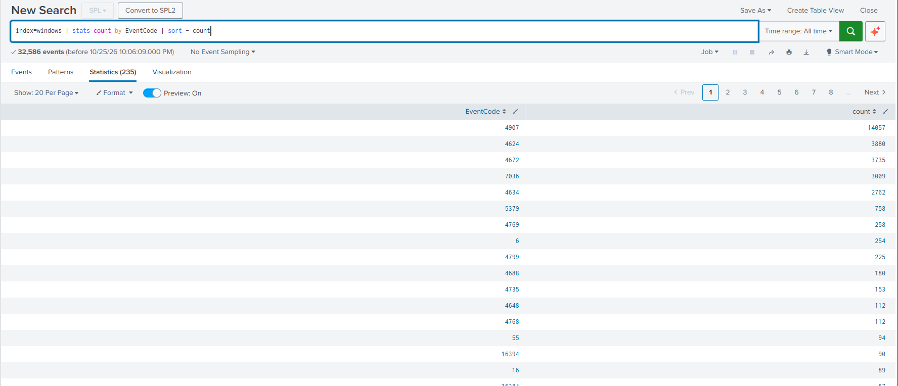
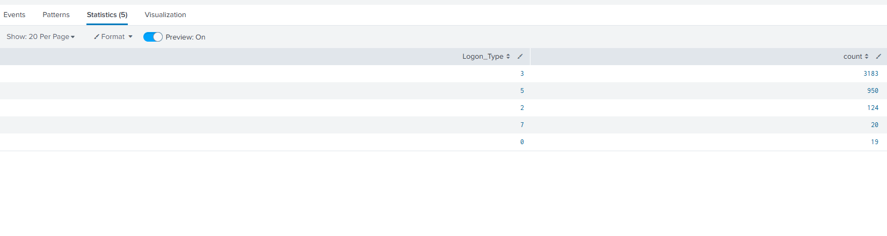

# Splunk Searches I Use

**No results? Check the time range first.** Field names are case-sensitive (`EventCode`, `Logon_Type`); values are not.

| Question | Search |
| --- | --- |
| Is data arriving? | `index=windows` |
| Which events are most common? | `index=windows \| stats count by EventCode \| sort -count` |
| Failed logons | `index=windows EventCode=4625` |
| Successful keyboard logons | `index=windows EventCode=4624 Logon_Type=2` |
| How are people logging in? | `index=windows EventCode=4624 \| stats count by Logon_Type \| sort -count` |
| Who logs in over the network? | `index=windows EventCode=4624 Logon_Type=3 \| stats count by Account_Name \| sort -count` |
| Failures, then success? (timeline) | `index=windows (EventCode=4625 OR EventCode=4624) Logon_Type=2 \| table _time EventCode Account_Name` |
| Anonymous logons | `index=windows EventCode=4624 Account_Name="ANONYMOUS LOGON"` |

## SPL building blocks

| Piece | Meaning |
| --- | --- |
| `index=windows` | Search only the Windows logs |
| `field=value` before the pipe | Filter |
| `\|` | Send results to the next command |
| `stats count by field` | Count per value of a field |
| `sort -count` | Biggest first (`sort count` = smallest first) |
| `table a b c` | Show only these columns |
| `"value with spaces"` | Quotes around values with spaces |

## Results from my lab

| EventCode counts | Logon types on DC1 |
| --- | --- |
|  |  |

Logon type baseline for DC1: Type 3 network 3,183 · Type 5 service 950 · Type 2 keyboard 124 · Type 7 unlock 20 · Type 0 system 19. No Type 10 (RDP).

Most common event: 4907 (audit setting changes), 14,057 events, mostly noise. The most common event is rarely the most important one.
